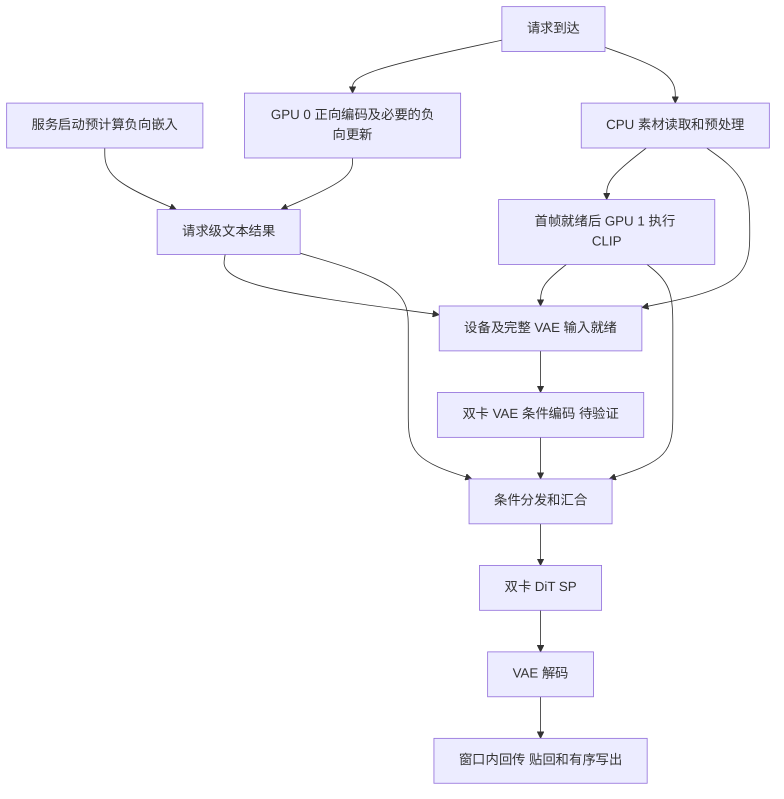

# 视频编辑单窗口双卡与四卡并行方案

本文整理截至 2026 年 10 月 4 日讨论确认的 VideoEdit 并行方案。目标是通过文本嵌入复用、首窗口文本与 CLIP 双卡并行、VAE 空间并行以及窗口内数据处理流水，缩短单窗口和完整请求耗时。双卡与四卡采用同一套阶段编排，各阶段分别选择参与设备和并行度。

本文为需求与设计文档，不代表新增能力已经实现或部署。VAE 空间并行、四卡运行配置及相应收益均待验证；本次只整理文档，不修改推理代码或服务配置。

## 一 范围与基本原则

纳入范围：

- 默认负向提示词服务启动时编码，负向文本变化时更新；正向提示词每请求编码一次，所有窗口共用。
- 首窗口正向文本编码与 CLIP 分别在两张卡执行。
- 同窗口 VAE 条件编码与解码的空间并行可行性验证。
- 既有 DiT 序列并行及其与各阶段资源调度的衔接。
- 当前窗口内 CPU 帧处理并行、权重搬运重叠、分批 D2H 与输出流水。
- 双卡与四卡按阶段分配设备，按实际尺寸选择适合的并行度。

不考虑多请求并发、吞吐调度、跨窗口读取/计算/输出重叠，以及两个方向窗口链的并行执行。文本嵌入跨窗口复用属于明确纳入的例外，不涉及窗口并行执行。

窗口仍按原顺序处理，原有 overlap、carry、bridge、尾部补齐和帧归属语义保持不变。服务运行期间视文本编码器权重、tokenizer 和编码精度等配置为固定，不设计这些配置的缓存失效或热更新机制。

不通过缩图、减少步数、改变 seed、精度或 TeaCache 阈值获得“并行加速”。设备数增加不意味着每个阶段都必须占满所有 GPU。

## 二 数据依据与优化取舍

以下来自最近核对的双 L40S、自适应驻留、49 帧单窗口实验。每个请求、每个阶段取两个 rank 中较慢的耗时；小裁剪取三次正式请求中位数，全帧两次分别列出。

| 实际模型输入 | CLIP 编码 | VAE 条件编码 |
| --- | ---: | ---: |
| 小裁剪 544×480，三次中位数 | 0.48 秒 | 2.88 秒 |
| 全帧 1920×1088，第一次 | 0.48 秒 | 24.04 秒 |
| 全帧 1920×1088，第二次 | 0.58 秒 | 24.69 秒 |

计时为同步后的完整 stage 耗时，包含阶段内预处理、适用的权重搬运、模型计算及清理，不是纯 GPU 算子时间。数据出自 `.local/adaptive-residency-20261004-v2/adaptive/rank0.jsonl` 和 `rank1.jsonl`；本机实验产物通常不随 Git 分发，关键数值已保留于上表。配置及实验边界见[自适应驻留报告](./adaptive_residency_20261004.md)，计时实现见[基准钩子](../../../scripts/videoedit_benchmark/hooks/benchmark_hook.py)。

由此调整优先级：

1. 文本先消除重复编码，复用收益单独统计。
2. 首窗口文本与 CLIP 并行合理，但仅隐藏 CLIP 的理想直接收益约为 0.5 秒，实际还受输入就绪时间和搬运影响。
3. 不将“一张卡长期负责 CLIP，另一张卡独立运行 VAE”作为主要方案。CLIP 结束后，应允许该卡参与耗时更长的 VAE。
4. 全帧 VAE 条件编码约 24 秒，优先研究空间并行；小裁剪只有约 2.88 秒，需要单独判断通信与融合是否划算。
5. VAE 解码、CPU 预处理、贴回与写出需补齐同配置计时，再确定投入优先级。

DiT 仍主导全帧总耗时：既有第二次全帧请求完整时间为 606.835 秒，DiT 为 532.295 秒。即使假设整个 24 秒条件编码阶段理想减半，也只节省约 12 秒，约占完整请求 2%。这只是理想估算，实际 stage 中并非所有工作都能平分。

## 三 文本编码与复用规则

| 内容 | 编码时机 | 复用范围 |
| --- | --- | --- |
| 默认负向提示词 | 服务启动时一次 | 后续负向文本不变的请求及其全部窗口 |
| 变更后的负向提示词 | 首次需要使用该新文本时一次 | 当前请求全部窗口，以及之后负向不变的请求 |
| 正向提示词 | 每个请求一次 | 当前请求所有窗口、所有 clip 和两个方向 |
| 后续窗口 | 不运行文本编码器 | 引用本请求已有正负嵌入 |

具体要求：

- 指定一个文本编码 owner，其他参与 DiT 的 rank 接收最终嵌入，不重复运行文本模型。
- 默认负向预计算在服务 ready 前完成，耗时计入启动时间。服务重启后重新预计算。
- 负向缓存判断只关注解析后的有效负向文本是否变化。首批只要求保留当前有效文本及其嵌入，不要求保存所有历史文本，也不引入多版本缓存系统。
- 负向文本变化时，编码成功后再替换缓存；失败不得将旧嵌入当作新文本结果使用。正向嵌入只需请求级保存，不要求跨请求复用。
- CFG 关闭时请求不消费负向嵌入，也不为未使用的新负向文本执行编码；以后需要负向条件时再比较并更新。服务启动默认负向预计算仍执行。
- 省略负向参数沿用现有默认值；显式空文本保持现有语义，不额外做可能改变输入的 trim 或归一化。
- 请求持有嵌入的只读引用，窗口 reset 不得导致重新编码。请求结束释放正向结果，服务级负向结果继续保留。
- 缓存最终嵌入即可，不要求整个文本编码器常驻 GPU。GPU 嵌入副本释放后可从 CPU 保存的结果恢复，搬运不是重新编码。
- 正向及变化后的负向编码可在同一 owner 上顺序执行，不新增编码器副本来并行正负分支。

### 调用次数验收

次数按所有 rank 合计，不包含拷贝和广播。N 表示任意窗口数，请求均顺序执行。

| 场景 | 正向新增编码次数 | 负向新增编码次数 |
| --- | ---: | ---: |
| 服务启动 | 0 | 1 |
| 使用当前负向，N 个窗口 | 1 | 0 |
| 下一请求负向不变，N 个窗口 | 1 | 0 |
| 负向变化且需要 CFG，N 个窗口 | 1 | 1 |
| 后续继续使用变更后的负向 | 1 | 0 |
| CFG 关闭，携带新的负向文本 | 1 | 0 |

## 四 双卡阶段分工

下表 GPU 0 和 GPU 1 是逻辑角色，可以在部署时交换。VAE 双卡空间并行为待验证目标，验证前保留已有路径。

| 阶段 | GPU 0 | GPU 1 | CPU |
| --- | --- | --- | --- |
| 服务启动 | 默认负向提示词编码并缓存 | 无需重复编码 | 初始化 |
| 请求及首窗口准备 | 正向编码；负向变化且需要时重算 | 实际首帧就绪后执行 CLIP | 视频与 mask 读取、当前窗口预处理 |
| VAE 条件编码 | 参与空间 tile 计算 | 参与空间 tile 计算 | 整理输入和元信息 |
| 条件汇合 | 获取所需文本、图像、mask 和 latent | 获取所需文本、图像、mask 和 latent | 调度 |
| DiT 去噪 | SP rank 0 | SP rank 1 | 必要的权重供给 |
| VAE 解码 | 按验证结果执行单卡或双卡方案 | 按解码方案参与 | 接收回传数据 |
| 输出 | 指定 owner 分批 D2H | 按需传输必要结果 | 转换、贴回并行，有序写出 |

### 首窗口时间关系

文本拿到请求即可运行，可与素材扫描和 CPU 准备重叠。CLIP 必须等待当前窗口实际首帧完成裁剪、缩放，因此两个编码分支不要求同时开始。

若使用双卡 VAE 编码，两卡各自完成文本或 CLIP 工作，并释放必要的编码器资源后，再共同进入 VAE。条件汇合完成后才能启动 DiT。不能为隐藏约 0.5 秒的 CLIP 耗时，使 VAE 的总体关键路径更长。



图中是目标调度，不表示现有实现已支持 VAE 空间并行。负向变化时，请求使用更新成功后的结果；CFG 关闭时无需负向条件。

### 后续窗口

后续窗口直接绑定请求级正负嵌入，仅重新准备当前窗口的视觉条件：

```text
当前窗口输入准备 → CLIP → VAE 条件编码 → 条件汇合
→ DiT SP → VAE 解码 → 当前窗口输出处理完成 → 下一窗口
```

当前窗口内新引入的后台转换、贴回和写入队列在窗口完成边界前收敛，不提前执行下一窗口。FFmpeg 进程及文件级最终封装沿用既有生命周期，不要求每窗口重新创建或关闭编码器。

## 五 四卡扩展

四卡保持阶段顺序，改变每阶段参与设备。不能通过单纯增加 GPU 数就假定非 DiT 模块已自动分工。

| 阶段 | 建议四卡分配 |
| --- | --- |
| 启动负向编码 | 指定一张卡执行一次，结果按需分发 |
| 首窗口文本与 CLIP | GPU 0 执行文本，GPU 1 执行 CLIP，GPU 2/3 不重复计算 |
| VAE 条件编码 | 若空间并行通过验证，四卡分担 tile；也允许选择更快的单卡或双卡方案 |
| DiT | 四卡组成 SP 组，验证模型、后端与 Ulysses/Ring 配置兼容性 |
| VAE 解码 | 独立选择一、二或四卡，不要求与 VAE encode 并行度相同 |
| 输出 | 指定输出 owner；其他卡按需提供结果；CPU 帧级并行 |

执行计划应描述文本 owner、CLIP owner、VAE encode 参与设备、DiT SP 组、VAE decode 参与设备和输出 owner。配置由服务端管理，不将硬件分工加入业务编辑参数。

各阶段参与设备可在预先建立的设备组中选择；无需每窗口重复创建通信组。未参与当前阶段的 rank 不重复计算，但必须遵守统一的阶段切换、就绪与异常协议。子组结果进入全体 DiT rank 时需要显式分发，不能依赖修改某个 rank 的请求对象自动同步。

四卡扩展要求重新验证显存、通信拓扑和收益。尤其小裁剪，四卡可能因通信与融合而慢于双卡；不承诺线性加速，也不为占满空闲 GPU 引入额外请求或窗口。

## 六 VAE 并行验证方案

### 条件编码

先拆分已有 stage 耗时：CPU/GPU 输入整理、权重上传、VAE 实际计算、归一化和结果整理。当前约 24 秒是完整阶段时间，不能直接全部除以设备数。

按相同模型、输入和精度比较：

| 方案 | 目的 |
| --- | --- |
| 当前各 rank 重复编码 | 保留可信基线 |
| 单 owner 编码并分发 latent | 测去重、通信和资源占用的净效果 |
| 两卡分担空间 tile | 验证实际并行收益及质量 |
| 四卡分担空间 tile | 验证扩展性，比较是否优于两卡 |

空间分片要求：

- 每个 tile 保留所需完整时间序列，不直接将不同时间帧交给不同 GPU 独立编码。
- 明确 tile 归属、边界上下文、重叠范围、结果 gather 及融合顺序；检查全局操作或状态是否使 tile 不能独立计算。
- 保持既有 VAE tiling 语义；如果相对当前基线新增 tiling 会改变结果，必须单独做正确性评估，不能包装成纯调度变更。
- 当前条件编码只需 masked video encode，不新增没有消费方的原视频 encode。
- 包含输入分发、权重加载和结果合并在内测净收益。合并处的完整 latent 和临时 buffer 纳入峰值预算。

全帧优先验证；小裁剪分别比较一、二、四卡耗时。选用策略以实测尺寸及成本为依据，初期可显式配置，不预设未经验证的尺寸阈值。

### 解码

先补齐小裁剪和全帧的同配置解码耗时，再比较复制解码、单 owner 解码和空间分片。单 owner 减少重复工作，不保证缩短关键路径。

非输出 rank 仍需获得后续顺序窗口所需的 carry/bridge 及元信息。数据分发应服务于必要上下文，避免广播整个全尺寸视频。现有整窗 decode 后分批 D2H 不等于已实现流式 VAE 解码。

时间轴分片暂不纳入实施要求。因果卷积和 feature cache 依赖需保留，不逐帧独立 decode 后直接拼接。

## 七 CPU 处理与传输重叠

- 当前窗口的视频和 mask 可由独立 reader 读取；每个 reader 只有一个读者，不并发 seek 同一管道。
- 独立帧的 mask 膨胀、裁剪、缩放可并行。跨帧平滑及有状态稳定器保持必要顺序，按帧索引归并后构造 tensor。
- 首帧 RGB 输入确定后尽早交给 CLIP，无需因其他帧尚未处理而无条件等待；VAE 等待它需要的完整输入。
- 权重预取可与其他模块计算重叠，但要检查显存及 PCIe 争用。不为预取挤出更多 DiT 驻留层，导致总耗时回退。
- 整窗 VAE decode 返回后，使用有界小批形成 D2H、CPU 转换、贴回、写出的流水；不同帧可并行贴回，writer 按原顺序提交。
- full 和 crop sidecar 共享适用的中间结果，但分别检查成功；最终合并、音频封装及文件发布仍按既有语义完成。

队列同时限制项数与字节数。GPU 源 tensor、pinned buffer 和 CPU 帧在异步消费完成前不得释放或复用；取消、超时和编码失败时停止生产并回收资源。

## 八 当前实现的改造边界

以下为本次已核对代码的接入位置，不表示已完成改造：

- [主 pipeline](../../../python/sglang/multimodal_gen/runtime/pipelines/wan_videoedit_pipeline.py) 的 `forward` 进入 `_forward_streaming`，应在真实入口接入请求级文本准备。
- [流式编排](../../../python/sglang/multimodal_gen/runtime/videoedit/streaming.py) 负责窗口输入、carry/bridge 和写出，窗口顺序保持不变。
- [模型 stages](../../../python/sglang/multimodal_gen/runtime/pipelines_core/stages/model_specific_stages/videoedit_wan.py) 当前文本、CLIP、条件编码仍顺序执行；文本阶段兼有 CLIP 权重预取职责，缓存跳过后需迁移该调度点，避免遗漏清理。
- [参数运行状态](../../../python/sglang/multimodal_gen/configs/sample/videoedit_wan.py) 的 `reset_window_runtime` 会清空文本嵌入，需将持久结果放在服务级或请求级上下文，窗口仅绑定引用。
- [执行器](../../../python/sglang/multimodal_gen/runtime/pipelines_core/executors/parallel_executor.py) 逐 stage 执行，不是自动 DAG 并发调度器；[stage 默认策略](../../../python/sglang/multimodal_gen/runtime/pipelines_core/stages/base.py) 为复制执行。需要显式 owner、子组和条件分发，不能只修改 GPU 数。
- [读写器](../../../python/sglang/multimodal_gen/runtime/videoedit/stream_io.py) 与 [单帧贴回](../../../python/sglang/multimodal_gen/runtime/videoedit/composite.py) 是窗口内输出流水的接入位置。
- [自动预算](../../../python/sglang/multimodal_gen/runtime/utils/videoedit_memory.py) 与 [模型生命周期管理](../../../python/sglang/multimodal_gen/runtime/utils/readonly_model_residency.py) 需覆盖同时活跃模块、通信和 staging buffer；预算不足时在执行前选择较低并行度或串行路径。

所有参与 rank 使用一致执行计划和通信顺序。owner 出错时错误传播到其他等待方，不能永久阻塞在 collective；异常后顺序执行的下一请求应能正常工作。

## 九 验收与实施顺序

### 验收要求

1. 文本调用次数符合第三节；服务启动预计算和请求执行分别计时。
2. 纯复用、分工、搬运与调度变更，默认要求条件 tensor、latent 和解码帧与基线一致，同时检查 TeaCache 决策。VAE 分片若改变浮点计算路径，需在采用前明确并通过单独的误差及画面质量验收。
3. 固定素材、实际尺寸、49 帧窗口和采样参数，分别报告文本准备、CLIP、VAE encode、DiT、VAE decode、输出及完整请求时间，不能将重叠阶段直接相加。
4. 比较同配置的一、二、四卡方案。每种形状预热后至少三次正式运行用于筛选，候选再做更多交错复测并报告分布；所有请求顺序运行，不开展吞吐测试。
5. 多窗口仅额外验证文本复用次数及其收益、已有窗口语义和状态清理，不通过跨窗口重叠获得加速。
6. 覆盖小裁剪、全帧、尺寸交错、尾部补齐、CLIP/CFG 开关、负向变化、慢 reader/writer、取消及失败恢复；记录各卡显存、CPU 内存和传输量。
7. 启用某项并行需证明完整阶段或请求收益大于测量波动，并保持质量和资源预算。局部 kernel 变快或更多 GPU 活跃不能单独作为验收通过依据。

### 实施顺序

| 顺序 | 工作 | 退出条件 |
| --- | --- | --- |
| 1 | 补齐单窗口基线和 VAE 阶段拆分 | 了解计算、搬运、CPU 处理和等待占比 |
| 2 | 负向服务缓存、正向请求级复用 | 调用次数及输出一致性通过 |
| 3 | 首窗口文本与 CLIP 双卡并行 | trace 确认重叠，条件一致且端到端无稳定回退 |
| 4 | 全帧 VAE 条件编码空间并行 | 两卡验证通过后扩展四卡，并独立评估小裁剪 |
| 5 | 根据解码计时验证 VAE 解码方案 | 分别确定 encode/decode 的有效设备数 |
| 6 | CPU 帧处理及当前窗口输出流水 | 有界资源下减少等待，帧顺序与媒体语义正确 |
| 7 | 组合验证双卡与四卡阶段调度 | 单项收益没有被竞争、通信或驻留变化抵消 |

最终交付包含实现、必要的正确性及异常测试、配置说明、真实模型实验记录和结论边界。本文没有承诺 VAE 分片已经可用，也不承诺四卡相对双卡的固定加速比。
